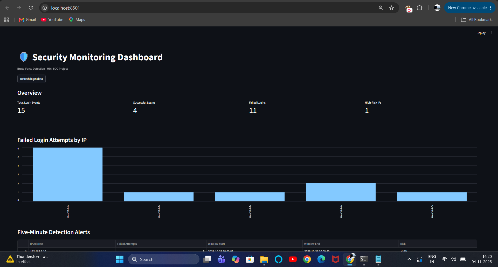

# Security Monitoring and Brute-Force Attack Detection Using Splunk

## Project Overview

This project is a security monitoring system designed to identify suspicious login activity and detect potential brute-force attacks.

It uses Python to analyze login records, identify repeated failed login attempts, and generate security alerts. Splunk is used to search, analyze, and visualize login events through a security monitoring dashboard.

A Streamlit dashboard provides a visual interface for monitoring detected security events.

## Objectives

- Detect suspicious login attempts.
- Identify repeated failed logins from the same IP address.
- Generate alerts when predefined thresholds are reached.
- Maintain a history of detected security incidents.
- Visualize security events using Splunk and Streamlit.
- Test detection functionality using Python unit tests.

## Technologies Used

| Technology | Purpose |
|---|---|
| Python | Brute-force detection logic |
| Splunk Enterprise | Log analysis and security monitoring |
| Streamlit | Interactive monitoring dashboard |
| Pandas | CSV data processing |
| CSV | Sample login and alert data |
| Git and GitHub | Version control and project hosting |

## Project Architecture
## Dashboard Preview

### Streamlit Security Monitoring Dashboard


1. Login events are stored in a CSV file.
2. The Python detector analyzes failed login attempts.
3. The detector identifies suspicious IP addresses based on a configured threshold.
4. Detected incidents are stored in alert history.
5. Streamlit displays monitoring information.
6. Splunk independently searches imported login and alert-history data and displays security insights.

**Note:** Python detection and Splunk log analysis currently operate as separate workflows using CSV data. Continuous automatic log forwarding is not yet implemented.

## Detection Logic

The Python detector uses the following configuration:

- Failed login threshold: 5 attempts
- Time window: 5 minutes
- Detection method: Repeated failed login attempts from the same IP address.

When the configured threshold is reached, the system generates an alert and records the incident.

## Project Structure

```text
BruteForceDetection/
│
├── detector.py
├── dashboard.py
├── test_detector.py
├── login_logs.csv
├── alert_history.csv
├── alerts.txt
├── requirements.txt
├── README.md
└── .gitignore
```

## Installation and Setup

### 1. Clone the repository

```bash
git clone https://github.com/Malavikaach/brute-force-detection-splunk.git
```

### 2. Navigate to the project folder

```bash
cd brute-force-detection-splunk
```

### 3. Create a virtual environment

```bash
python -m venv .venv
```

### 4. Activate the environment (Windows)

```powershell
.venv\Scripts\Activate.ps1
```

### 5. Install dependencies

```bash
pip install -r requirements.txt
```

## Running the Project

### Run the Python detector

```bash
python detector.py
```

### Run the Streamlit dashboard

```bash
streamlit run dashboard.py
```

### Run unit tests

```bash
python -m unittest test_detector -v
```

## Splunk Detection Query

The following SPL query identifies IP addresses with at least five failed login attempts within a five-minute time bucket:

```spl
index=main source="*login_logs.csv*"
| eval status=upper(status)
| search status="FAILED"
| bin _time span=5m
| stats count AS failed_attempts BY ip_address _time
| where failed_attempts >= 5
| table _time ip_address failed_attempts
| sort - failed_attempts
```

## Testing

The Python detector was tested using unit tests covering:

- Detection of repeated failed login attempts.
- Login attempts below the configured threshold.
- Attempts spread across different time windows.
- Unsorted timestamps.
- Alert history generation.
- Prevention of duplicate alert records.

**Test result:** 7 unit tests passed.

## Future Improvements

- Automatic log ingestion into Splunk.
- Real-time security monitoring.
- Email notifications for critical alerts.
- More advanced detection rules.
- Integration with SIEM alerting workflows.

## Skills Demonstrated

- Python programming
- Cybersecurity fundamentals
- Brute-force attack detection
- Log analysis
- Splunk Search Processing Language (SPL)
- Security monitoring and SIEM
- Dashboard development
- Unit testing
- Git and GitHub

## Disclaimer

This project is intended for educational purposes. The included login records should be synthetic or sanitized sample data. It is not a production-grade security monitoring solution.